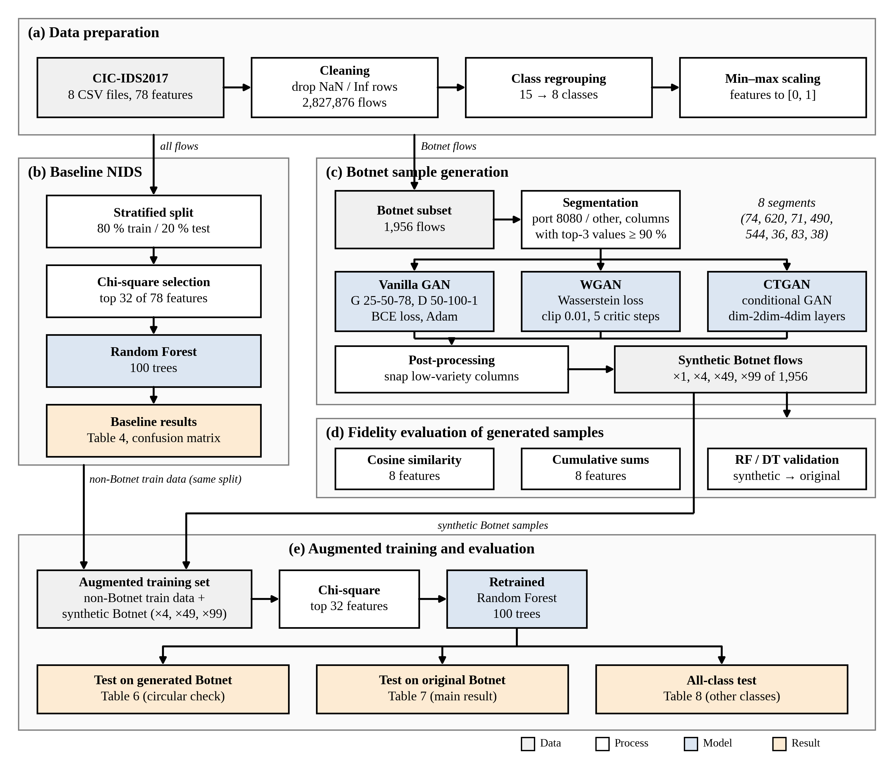

# GAN-based NIDS Enhancement: A Reproduction Study

Reproduction of **Zhao, Fok & Thing (2024), "Enhancing network intrusion detection performance using generative adversarial networks", *Computers & Security* 145, 104005**, on the CIC-IDS2017 dataset.

Attack classes such as Botnet are rare, so a machine-learning intrusion detector misses them: in CIC-IDS2017 Botnet has 1,956 flows against 2,271,320 benign flows, and a Random Forest baseline detects only 47% of it. The base paper generates synthetic Botnet flows with GANs (Vanilla GAN, WGAN, CTGAN) and retrains the detector on the augmented data. This repository re-implements that pipeline end to end (PyTorch, scikit-learn) and reports honestly what reproduces and what does not.



*Editable diagram: [`working_architecture.drawio`](working_architecture.drawio) (open at [app.diagrams.net](https://app.diagrams.net)); vector version: [`working_architecture.svg`](working_architecture.svg).*

## Summary of results

**Reproduces exactly:** class counts (all 15 classes, difference 0), preprocessing, baseline accuracy (0.9972) and baseline Botnet F1 (0.60).

**Reproduces in direction:** GAN augmentation raises Botnet F1 on *original* traffic from 0.60 to about 0.80 with WGAN, with diminishing returns beyond 49x, and leaves the other classes stable.

**Does not reproduce:** the paper's highest values (Botnet F1 up to 0.90).

### Baseline NIDS (Random Forest, chi-square top 32 features, 80/20 split)

| | Precision | Recall | F1 |
|---|---|---|---|
| Botnet, this work | 0.83 | 0.47 | 0.60 |
| Botnet, base paper | 0.87 | 0.46 | 0.60 |

Accuracy: **0.9972** (paper 0.9972). See [`03_baseline_confusion_matrix.png`](03_baseline_confusion_matrix.png): 206 of 391 Botnet test flows are classified as Benign, which is the weakness the paper targets.

### Botnet detection on the original Botnet flows (the paper's Table 7)

Random Forest trained with synthetic Botnet flows replacing the original class (x = multiple of the original 1,956 flows), tested on the original Botnet flows. F1-score, this work / base paper:

| Generator | x4 | x49 | x99 | Recall at x99 |
|---|---|---|---|---|
| WGAN | 0.79 / 0.85 | 0.80 / 0.87 | 0.79 / 0.90 | 0.70 / 0.82 |
| CTGAN | 0.66 / 0.60 | 0.72 / 0.86 | 0.72 / 0.87 | 0.59 / 0.77 |
| Vanilla GAN | 0.56 / 0.80 | 0.61 / 0.87 | 0.62 / 0.90 | 0.46 / 0.81 |

Baseline Botnet F1 is 0.60. The tests on *generated* Botnet data (the paper's Tables 6 and 8) score 0.95 to 1.00, in line with the paper, but that setting is circular; the table above is the meaningful result. Charts: [`09_table7_original_botnet.png`](09_table7_original_botnet.png), [`08_table6_generated.png`](08_table6_generated.png), [`10_wgan99_per_class.png`](10_wgan99_per_class.png).

### Fidelity of the generated samples

Cosine similarity ([`04_cosine_similarity.png`](04_cosine_similarity.png)) is close to or above the paper on some features (Packet Length Mean, Init_Win_bytes_backward) and lower on others (Flow Duration: 0.33 to 0.65 against 0.83 to 0.90). Cumulative-sum plots: [`05`](05_cumsum_vanilla_gan.png), [`06`](06_cumsum_wgan.png), [`07`](07_cumsum_ctgan.png).

## Why the numbers differ from the paper

The paper does not state: GAN training length, batch size, optimiser and learning rates, noise dimension, the WGAN clipping or gradient penalty, the CTGAN loss and label, the Botnet segmentation threshold, scaling, post-processing of generated samples, Random Forest settings, or the random seed. These were chosen here (see `paper_replica.py`), and the final choices were selected by comparing validation runs on real Botnet recall. All runs are listed:

| Run | Change | Recall on real Botnet (Vanilla / WGAN / CTGAN) |
|---|---|---|
| 1 | 3,000 steps, strict segmentation, no snapping | 0.00 / 0.00 / 0.00 |
| 2 | 10,000 steps, snapping, 5 segments | 0.12 / 0.63 / 0.60 |
| 3 | 30,000 steps, snapping | 0.61 / 0.62 / 0.02 |
| 4 | 30,000 steps, no snapping | 0.00 / 0.00 / 0.00 |
| **5 (final)** | 10,000 steps, snapping, 8 segments (`--seg_cover 0.9`) | 0.33 / 0.66 / 0.65 |
| 6 | run 5 plus port snapping (`--snap_port`) | 0.36 / 0.68 / 0.65 |

Findings from the diagnostics:

- A Random Forest trained on **real** Botnet flows reaches recall **0.99** (`diag_oracle.py`), so the data are separable and the gap is not a data problem.
- Classifiers trained on generated flows recognise the port-8080 Botnet segments well but largely fail on the non-8080 segments (`diag_segments.py`).
- Snapping near-constant columns to their real values is essential; training three times longer gave no gain.

Limitations: single runs (seed 42) without confidence intervals; one dataset and one attack class; random split of CIC-IDS2017 (near-duplicate flows can overstate detection).

## Pipeline

1. **Data preparation:** 8 CSV files, 78 features; drop rows with NaN or infinite values (2,827,876 flows); regroup 15 labels into 8 classes; min-max scale.
2. **Baseline:** stratified 80/20 split, chi-square top 32 features, Random Forest (100 trees).
3. **Botnet generation:** split Botnet flows by destination port (8080 or other) and by low-variety columns into 8 segments; train a Vanilla GAN, WGAN and CTGAN per segment; snap low-variety columns to real values; generate x1, x4, x49 and x99.
4. **Fidelity checks:** cosine similarity, cumulative sums, Random Forest / Decision Tree validation.
5. **Augmented training and evaluation:** replace the original Botnet class by synthetic flows, retrain, test on generated Botnet, original Botnet and all classes.

## Repository contents

| File | Purpose |
|---|---|
| `paper_replica.py` | Full pipeline (data cleaning, baseline, segmentation, GANs, similarity tests, augmentation) |
| `make_charts.py` | Charts comparing results with the paper |
| `confusion_matrices.py` | Confusion matrices of the baseline and augmented models |
| `diag_segments.py` | Per-segment recall of classifiers trained on generated flows |
| `diag_oracle.py` | Ceiling test with a classifier trained on real Botnet flows |
| `paper_replica_notebook.ipynb` | Runs the pipeline in the background and displays tables and figures |
| `01_*.png` to `10_*.png` | Result figures |
| `working_architecture.*` | Architecture diagram (PNG, SVG, editable draw.io) |

## Setup

```bash
pip install -r requirements.txt
```

Download **CIC-IDS2017** (the `MachineLearningCSV` / `MachineLearningCVE` folder with 8 CSV files) from the [Canadian Institute for Cybersecurity](https://www.unb.ca/cic/datasets/ids-2017.html). The dataset is **not** included in this repository; please follow its terms and cite Sharafaldin et al. (2018).

## Usage

```bash
# 1. quick check on synthetic data (about one minute)
python paper_replica.py --demo

# 2. final configuration used in this work
#    (GAN training is the slow part; generated samples are cached in <out>/cache and reused)
python -u paper_replica.py --data_dir /path/to/MachineLearningCVE --out runC \
       --steps 10000 --snap --seg_cover 0.9

# 3. charts, confusion matrices and diagnostics from a finished run
python make_charts.py --run runC
python confusion_matrices.py --data_dir /path/to/MachineLearningCVE --run runC
python diag_segments.py --data_dir /path/to/MachineLearningCVE --run runC --seg_cover 0.9
python diag_oracle.py   --data_dir /path/to/MachineLearningCVE --seg_cover 0.9
```

Options: `--validate_only` (stop after the similarity checks), `--snap_port`, `--steps`, `--trees`, `--seed`, `--lr`. Results are written to the `--out` folder (`tables/`, `figures/`, `cache/`).

A full run needs several GB of RAM and many CPU cores for the Random Forest fits (roughly 1 to 3 hours on a shared server); the GANs are small and run on CPU or GPU.

**Troubleshooting:** if `import torch` fails with `undefined symbol: __nvJitLinkAddData_12_5`, install a matching library into a user folder (`pip install --target ~/nvfix "nvidia-nvjitlink-cu12>=12.5,<12.7"`) and run with `LD_PRELOAD=~/nvfix/nvidia/nvjitlink/lib/libnvJitLink.so.12`.

## Reference

Zhao, X., Fok, K.W., Thing, V.L.L. (2024). Enhancing network intrusion detection performance using generative adversarial networks. *Computers & Security*, 145, 104005.

Sharafaldin, I., Lashkari, A.H., Ghorbani, A.A. (2018). Toward generating a new intrusion detection dataset and intrusion traffic characterization. *ICISSP*, 1, 108-116.

This is an independent reproduction for a university project. It contains no material from the paper and no data from the dataset.

## License

MIT, see [`LICENSE`](LICENSE).
